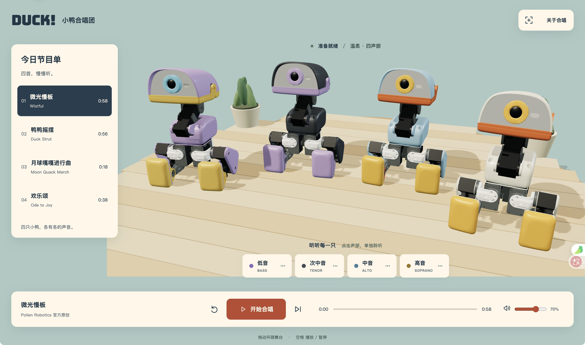

# 小鸭合唱团 · MicroDuck Singing

四只 MicroDuck，四种声音，四首小小的合唱。基于 Pollen Robotics 的[四鸭合唱视频](https://www.youtube.com/watch?v=ZsSoyMcggpU)、[合唱案例](https://iagai.cn/reference/commands/chorale/index.html)，延续小鸭足球赛和小鸭环岛赛的浏览器体验。



## 四首曲目

| 曲目 | 来源 | 时长 |
| --- | --- | --- |
| 微光慢板 · Wistful | Pollen Robotics 官方原创，原速 58 BPM | 约 59 秒 |
| 鸭鸭摇摆 · Duck Strut | Pollen Robotics 官方原创，原速约 126 BPM | 约 57 秒 |
| 月球嘎嘎进行曲 · Moon Quack March | 本项目原创，128 BPM | 约 19 秒 |
| 欢乐颂 · Ode to Joy | 贝多芬公版旋律，本项目四声部改编，100 BPM | 约 38 秒 |

没有包含 Outer Wilds 测试素材、第三方录音或歌词。

## 本地运行

建议 Node.js 22 及以上。

```sh
npm ci
npm run dev
```

打开 http://127.0.0.1:5177 。如果端口已占用，以 Vite 输出的实际地址为准。

```sh
npm test
npm run build
npm run preview
```

`dist/` 是可独立部署的静态站点；默认使用相对资源路径。GitHub Pages 构建可设置 `BASE_PATH=/microduck-singing/`。不需要训练服务器、音频服务或后台。

## 使用

- 点击节目单切换四首曲目。演唱中换曲立即从新曲开头开始；暂停时选曲等待播放。
- 点击“开始合唱”解锁浏览器声音；可暂停、继续、从头演唱和切到下一首。
- 点击一个声部进入独唱，再点一次或点“恢复四声部”恢复合唱。
- 音量滑块调整总音量。拖动舞台环顾、滚轮缩放，“恢复舞台视角”回到默认近景构图，优先展示小鸭主体。手机采用更宽视野，保留完整四鸭。
- 空格播放／暂停；按钮和滑块保留原生键盘操作。切到后台自动暂停。
- 手机按舞台、节目单、声部和播放控制排列，可以向下滚动。

## 实现与边界

Three.js 渲染本地 MicroDuck GLB 和运动学骨架。四只小鸭保持固定坐姿，嘴部与头部按乐谱表达，属于运动学展示，没有运行 MuJoCo 或强化学习策略。

Web Audio 将官方音色公式改编成四个独立的七谐波声部。音频调度和画面共同读取 AudioContext 时钟；用 120 ms 调度窗口抵抗短时主线程抖动，长时间卡顿时跟上当前拍点。自然结束后停止发声并等待重唱；暂停与换曲销毁旧声源。

这是本地合唱的浏览器改编，不是逐样本一致的 Rust 音频、BLE 多机同步或硬件验收。

## 验证

- `npm test`：四首完整乐谱、四声部有效性、终曲静音、独唱隔离，以及播放／暂停／重唱／换曲／结束／重放生命周期。
- `npm run build`：独立生产构建。
- `.impeccable/review/`：当前近景为 1450×857 桌面与 390×945 手机截图，近景修正审查为 `ship`；1440×900、1280×720 是较早远景版本。
- `tests/audio-check.html`：开发服务中的手动 OfflineAudioContext 整曲输出检查工具；不进入生产构建。

## 许可证

本项目代码及官方音乐源码改编采用 Apache-2.0。机器人几何资源保留 Pollen Robotics 的 **CC BY-NC-SA 4.0** 条款；Bungee 为 SIL OFL。完整来源、固定版本及改编范围见 [THIRD_PARTY.md](THIRD_PARTY.md)、`reference/source-lock.json` 和 `public/licenses/`。
